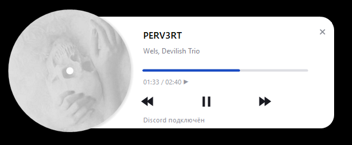

# HishiAudio

Windows-приложение для передачи текущего трека Яндекс Музыки в Discord Rich Presence.

**Сайт разработчика:** [hishi.icu](https://hishi.icu)

## Возможности

- Отображение трека, исполнителя и времени воспроизведения в Discord.
- Кнопка **«Слушать на ЯМ»** с прямой ссылкой на текущий трек.
- Кнопка **developer** со ссылкой на [hishi.icu](https://hishi.icu).
- Управление воспроизведением: пауза, предыдущий и следующий трек, перемотка.
- Окно без рамки с вращающейся обложкой и работа в трее.
- Запуск Яндекс Музыки с локальным портом отладки без консоли.

## Требования

- Windows 10 версии 1809 или новее / Windows 11, x64.
- [.NET Framework 4.8](https://dotnet.microsoft.com/en-us/download/dotnet-framework/net48).
- Установленное приложение Яндекс Музыки.
- Запущенный настольный Discord.

Установка .NET SDK и сторонних пакетов не требуется.

## Запуск

1. Запустите `HishiAudio-0.6.3.exe`.
2. Включите трек в Яндекс Музыке.
3. Разрешите отображение текущей активности в настройках Discord.

Приложение запускается в трей. Откройте окно двойным щелчком по значку. Нажмите крестик, чтобы свернуть окно в трей. Выберите **«Выход»** в меню значка, чтобы завершить работу.

Для распространения достаточно одного EXE: ресурсы встроены. Перед обновлением завершите старую версию через трей.

### Перезапуск Яндекс Музыки

HishiAudio использует локальный порт `127.0.0.1:19229` для получения точной ссылки на трек.

Если плеер уже работает без доступного порта, приложение:

1. Отправляет команду штатного закрытия.
2. Ждёт до четырёх секунд.
3. Завершает оставшиеся процессы с совпадающим полным путём к EXE плеера.
4. Запускает плеер с отладочным портом без консоли.

Перезапуск прерывает воспроизведение. Плеер с доступным портом не перезапускается. Если стандартный путь установки не найден, выберите EXE Яндекс Музыки в диалоге.

## Сборка

Запустите из каталога проекта:

```bat
Build.cmd
```

Скрипт использует встроенный компилятор C# .NET Framework и WinRT-метаданные Windows. Результат: `HishiAudio-0.6.3.exe` в каталоге проекта.

## Тестирование

Закройте Discord и запустите:

```bat
Test.cmd
```

IPC-тест использует канал `discord-ipc-0`. Тестовые EXE создаются в отдельном временном каталоге; скрипт выводит его путь.

Проверки покрывают:

- Формирование активности, кнопок и IPC-сообщений.
- Обработку паузы и временного отсутствия данных плеера.
- Проверку прямых ссылок и совпадения метаданных.
- Параметры запуска и решение о перезапуске плеера.
- Вращение обложки, альфа-прозрачность и центрирование кнопки закрытия.

Тесты не запускают и не завершают реальную Яндекс Музыку.

## Принцип работы

- **WinRT Media Control** предоставляет метаданные, обложку и команды управления плеером.
- **Chrome DevTools Protocol** читает идентификаторы текущего трека и альбома из состояния Sonata в установленной Яндекс Музыке.
- **Discord IPC** передаёт активность локальному клиенту Discord.
- **WinForms / GDI+** отрисовывают окно с альфа-прозрачностью. Неподвижная часть кадра кэшируется.

Прямая ссылка используется только при совпадении названия и исполнителя с Windows-медиасессией. При ошибке чтения кнопка открывает главную страницу Яндекс Музыки.

## Ограничения

- Чтение Sonata зависит от внутренней структуры плеера; исследована версия Яндекс Музыки `5.124.1`.
- Свои кнопки Rich Presence видны другим пользователям, но не владельцу активности.
- Цвет кнопок и слово «Слушает» определяет Discord.
- Доступность обложки и перемотки зависит от медиасессии плеера.
- После восьми секунд паузы или отсутствия данных активность скрывается.
- Показ уведомлений зависит от настроек Windows.
- Разные масштабы DPI и конфигурации мониторов проверены не полностью.

## Данные и подключения

- Пароли и токены Discord/Яндекса не требуются.
- Приложение не читает cookies, историю прослушиваний и `localStorage`.
- Подключение к CDP ограничено `127.0.0.1:19229`; подключение к Discord использует локальный IPC.
- Сведения о текущем треке отображаются в профиле Discord.
- EXE не подписан цифровым сертификатом. Антивирусные предупреждения требуют отдельной проверки; наличие исходников не заменяет анализ сборки.

Чтобы отключить режим отладки плеера, полностью закройте Яндекс Музыку и запустите её обычным ярлыком.

## Структура

| Файл | Назначение |
| --- | --- |
| `App.cs` | Трей, медиасессия, команды плееру и обновление активности |
| `PlayerForm.cs` | Интерфейс, альфа-прозрачность и кэш отрисовки |
| `DiscMotion.cs` | Расчёт вращения обложки |
| `PlayerStartup.cs` | Запуск и перезапуск Яндекс Музыки |
| `TrackLink.cs` | Чтение Sonata и проверка прямой ссылки |
| `Core.cs` | Discord IPC и удержание активности при кратких разрывах |
| `AssemblyInfo.cs` | Метаданные сборки |
| `cover.jpg`, `hishi.ico` | Обложка по умолчанию и иконка |
| `tests/` | Автоматические проверки |

## Лицензии

### Исходный код HishiAudio

Исходный код распространяется по [MIT License](LICENSE).

Copyright (c) 2026 hishi.

При распространении копий или существенных частей кода сохраняйте уведомление об авторских правах и текст лицензии. Лицензия не требует отображать авторство в интерфейсе и не распространяется на сторонние изображения и компоненты.

### Платформенные компоненты

Проект не использует сторонние NuGet-пакеты и не включает их исходный код.

| Компонент | Использование | Условия |
| --- | --- | --- |
| Microsoft .NET Framework 4.8, WinForms, GDI+ | Среда выполнения, интерфейс и системные библиотеки | Лицензионные условия установленной версии Microsoft .NET Framework / Windows; [страница .NET Framework 4.8](https://dotnet.microsoft.com/en-us/download/dotnet-framework/net48) |
| Windows WinRT / Win32 API и системные метаданные | Медиасессии и отрисовка окна | Условия лицензии установленной Windows; [Microsoft Software License Terms](https://www.microsoft.com/useterms) |
| Discord IPC и Chrome DevTools Protocol | Реализация обмена по протоколам | SDK Discord, Electron и Chromium в поставку не входят; лицензии этих SDK не назначаются коду HishiAudio |

Библиотеки Microsoft и системные WinRT-метаданные используются из установленной Windows и не копируются в каталог проекта. Лицензии современного .NET и репозитория `win32metadata` не подменяют условия этих системных компонентов.

### Изображения и сторонние приложения

- Права на `cover.jpg`, `hishi.ico` и изображения на скриншотах принадлежат соответствующим правообладателям. Отдельная лицензия на эти материалы не указана.
- Яндекс Музыка и Discord устанавливаются отдельно и используются на условиях их правообладателей.
- HishiAudio не является официальным приложением Яндекса или Discord.
